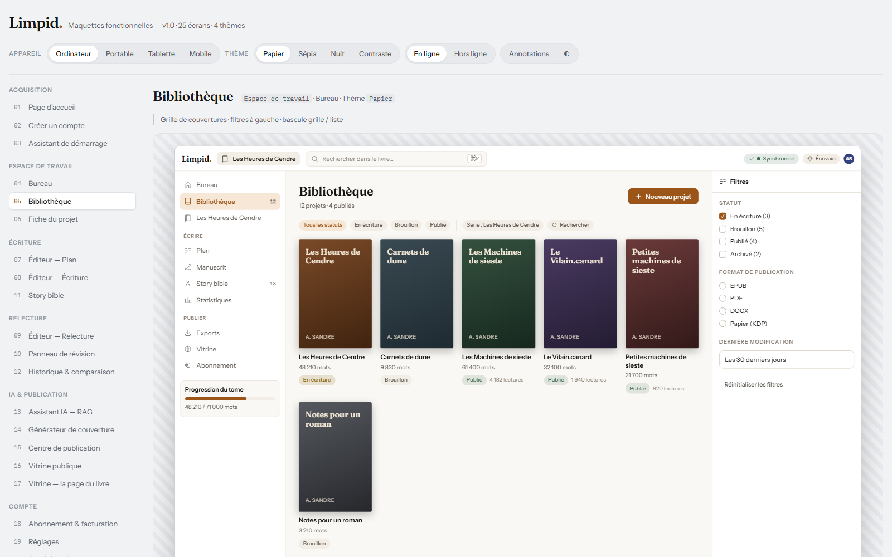
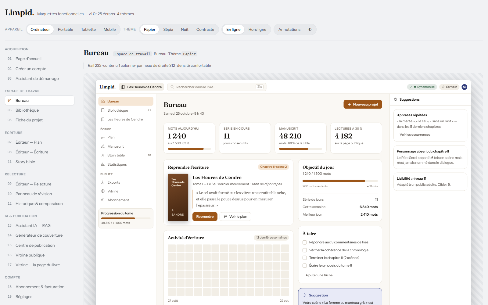
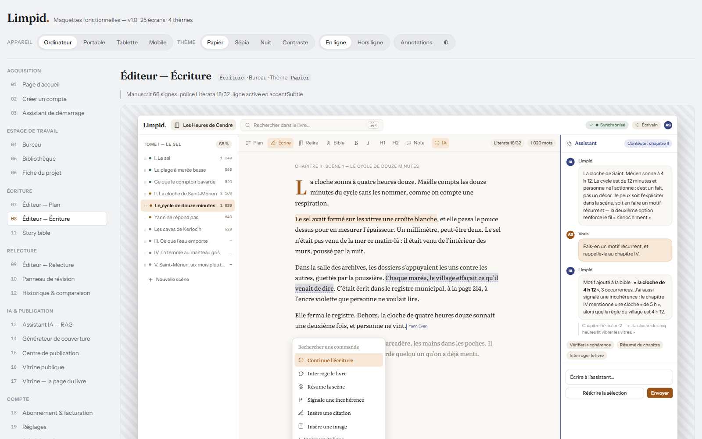
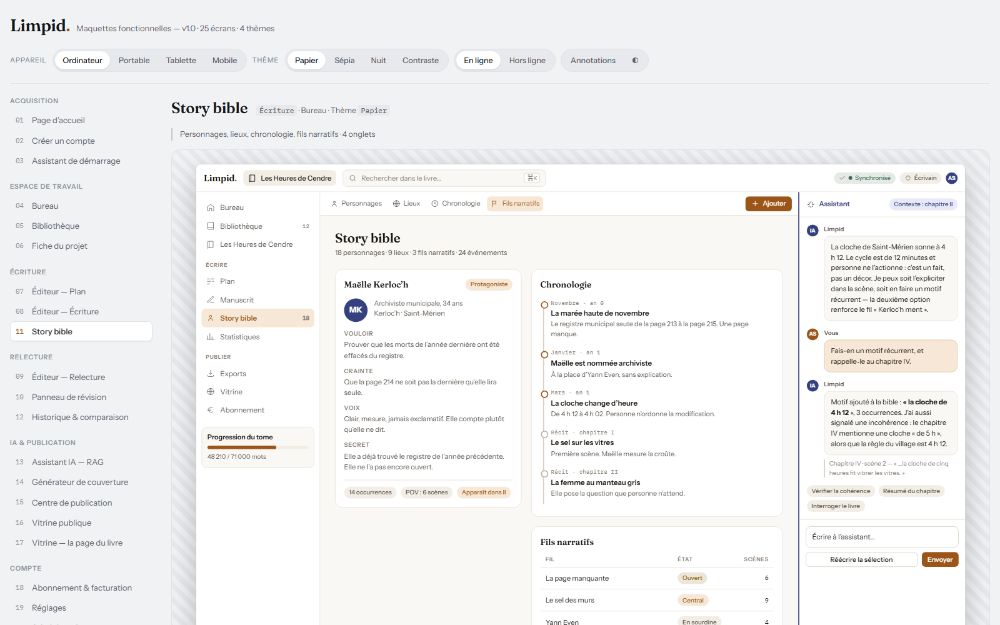
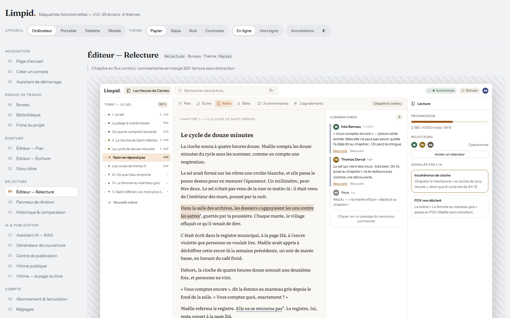
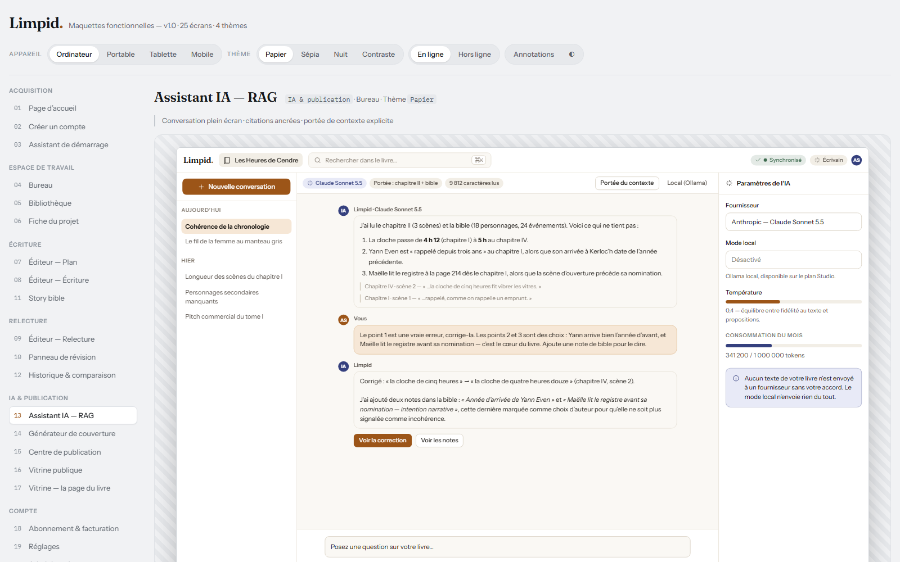
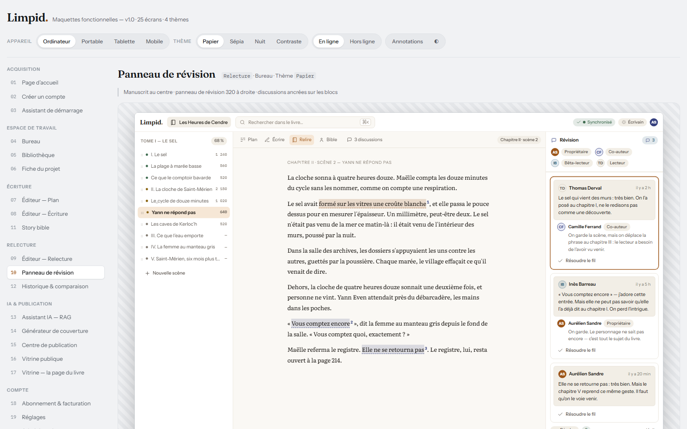
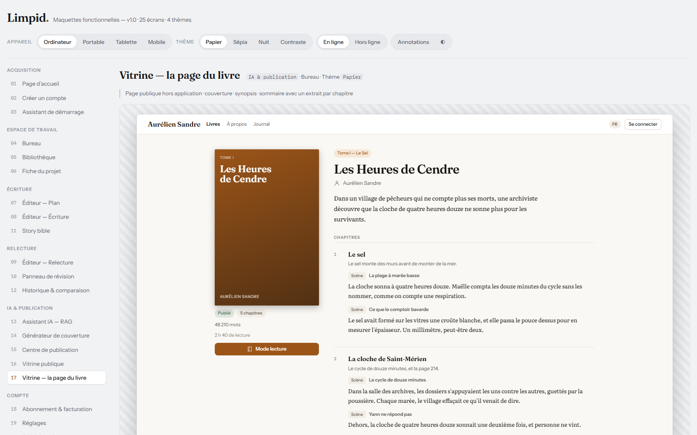

# Limpid

Limpid est un studio d'écriture en ligne pour auteurs indépendants.
Un livre s'y structure en cinq niveaux : projet, série, tome, chapitre, scène.
L'écriture fonctionne intégralement hors-ligne, sur six cibles, à partir d'une seule base Flutter.
La synchronisation entre appareils converge sans arbitrage, grâce à un CRDT par bloc écrit en Dart pur.
L'IA relit le manuscrit entier, puis le livre sort en EPUB, PDF, DOCX, HTML, Markdown ou ODT, se vend en ligne et se distribue chez Amazon KDP.

## Captures

Les maquettes sont regroupées dans `mockups/limpid-mockups.html`, générées à
partir des valeurs de `packages/limpid_design_system/tokens.json` (D-11). Les
captures PNG servent de référence au contrôle visuel de chaque écran.

| Bibliothèque | Tableau de bord | Éditeur |
|---|---|---|
|  |  |  |

| Story Bible | Révision | Assistant IA |
|---|---|---|
|  |  |  |

| Panneau de révision | Vitrine du livre | Vitrine (mobile) |
|---|---|---|
|  |  |  |

Autres captures : `mockups/shot-editor-plan.png`, `mockups/shot-editor-history.png`,
`mockups/shot-offline.png`, `mockups/shot-cover.png`, `mockups/shot-publish.png`,
`mockups/shot-storefront.png`, `mockups/shot-onboarding.png`, `mockups/shot-signup.png`,
`mockups/shot-command.png`, `mockups/shot-settings.png`, `mockups/shot-billing.png`,
`mockups/shot-admin.png`, `mockups/shot-landing.png`, `mockups/shot-project.png`,
`mockups/shot-m-dashboard.png`, `mockups/shot-m-editor.png`.

## Pile de technologies

| Couche | Choix | Version |
|---|---|---|
| Langage | Dart et Flutter | 3.12 et 3.44 |
| État et navigation | Riverpod 3 avec génération de code, `go_router` | 3 |
| Base locale | Drift, SQLite avec FTS5 | — |
| Modèle partagé et design system | `packages/limpid_core` (Dart pur), `packages/limpid_design_system` | — |
| Éditeur | `flutter_quill` forké en `packages/limpid_quill` | — |
| API | Dart `shelf` et `shelf_router`, monolithe modulaire | — |
| Base et authentification | PostgreSQL managé (Supabase) en production, SQLite en développement (D-29) ; Supabase Auth avec JWT validé par JWKS | — |
| Stockage et files | Cloudflare R2 compatible S3, Redis | — |
| Temps réel | WebSocket sur l'API | — |
| IA | Passerelle Dart multi-fournisseurs, Anthropic Claude par défaut | — |
| CI | GitHub Actions | — |

## Structure du dépôt

```
Limpid/
├─ apps/
│  ├─ limpid_app/           # Flutter : web (PWA) + mobile + desktop
│  └─ limpid_api/           # Dart Shelf sur Railway
├─ packages/
│  ├─ limpid_core/          # Dart pur : entités, CRDT, règles métier
│  ├─ limpid_design_system/ # Dart : tokens et widgets
│  ├─ limpid_quill/         # Fork de l'éditeur
│  ├─ limpid_ai/            # Passerelle IA multi-fournisseurs
│  ├─ limpid_export/        # Générateurs EPUB, PDF, DOCX
│  └─ limpid_sync/          # Client de synchronisation et transport
├─ docs/                    # Documentation normative
├─ mockups/                 # Maquettes HTML et captures de référence
├─ tools/                   # Vérification du monorepo
└─ pubspec.yaml             # Workspace Dart
```

## Commandes de développement

Prérequis : Flutter 3.44 et Dart 3.12 sur le `PATH`.

```bash
flutter pub get                                    # Dépendances du workspace
dart run build_runner build --delete-conflicting-outputs   # Riverpod, Drift, sérialisation
dart analyze                                       # Analyse statique
dart format --set-exit-if-changed .                # Formatage
flutter test                                       # Unitaires, widgets, goldens
flutter test packages/limpid_core/test/sync/       # Fuzz de convergence, bloquant en CI
flutter run -d chrome                              # Lancement local web, PWA
flutter run -d windows                             # Lancement local desktop
flutter build web --release                        # Build PWA
python apps/limpid_app/tool/setup_web_assets.py    # Fichiers WASM de Drift pour le web
bash tools/verify.sh                              # Analyse + tests de tous les paquets
node mockups/tools/check-html.js                  # Balisage des maquettes
node mockups/tools/check-colors.js                # Couleurs en dur des maquettes
```

Pour ouvrir le build de release dans un navigateur, sans watcher de
compilation :

```bash
cd apps/limpid_app/build/web && python -m http.server 8090
# puis http://127.0.0.1:8090/
```

L'API locale se lance depuis la racine, sans aucune variable à renseigner :

```bash
dart run apps/limpid_api/bin/server.dart
```

**Aucun service externe n'est nécessaire pour démarrer l'API** : par défaut elle
écrit dans un fichier SQLite local (D-29), applique ses migrations au
démarrage et sert `/health`.

| Variable | Rôle |
|---|---|
| `LIMPID_DB_DRIVER` | `sqlite` (défaut) ou `postgres` |
| `LIMPID_DB_PATH` | Chemin du fichier SQLite, défaut `.limpid/limpid.db` |
| `DATABASE_URL` | Connexion PostgreSQL managé — **requis si `LIMPID_DB_DRIVER=postgres`** |
| `SUPABASE_URL`, `SUPABASE_ANON_KEY`, `SUPABASE_JWKS_URL` | Supabase Auth et validation des jetons |
| `REDIS_URL` | Files d'attente et cache |
| `R2_ENDPOINT`, `R2_ACCESS_KEY_ID`, `R2_SECRET_ACCESS_KEY` | Stockage des fichiers |
| `ANTHROPIC_API_KEY` | Fournisseur IA par défaut |
| `STRIPE_SECRET_KEY` | Paiement et facturation |
| `API_RATE_LIMIT_CAPACITY`, `API_RATE_LIMIT_REFILL_PER_SECOND` | Limitation de débit de l'API, par compte |
| `AI_RATE_LIMIT_CAPACITY`, `AI_RATE_LIMIT_REFILL_PER_SECOND` | Limitation de débit des routes d'IA |
| `LIMPID_PURGE_INTERVAL_SECONDS` | Intervalle entre deux passes du worker de purge RGPD, défaut 3600 |
| `PORT` | Port d'écoute de l'API |

## Documentation

| Document | Contenu |
|---|---|
| [`docs/PROMPT.md`](docs/PROMPT.md) | Cahier des charges et prompt de construction |
| [`docs/DECISIONS.md`](docs/DECISIONS.md) | Journal de décisions, D-01 à D-33 |
| [`docs/ARCHITECTURE.md`](docs/ARCHITECTURE.md) | Architecture, synchronisation, API, déploiement |
| [`docs/ROADMAP.md`](docs/ROADMAP.md) | Les 8 lots de la v1, risques, hors périmètre |
| [`docs/FEATURE_MATRIX.md`](docs/FEATURE_MATRIX.md) | Les fonctions v1, leur origine et leur couverture |

## Statut du projet

| Élément | État |
|---|---|
| Version | 0.1.0, socle gelé le 2026-10-25 |
| Conception | Terminée : architecture, décisions, périmètre fonctionnel, feuille de route, maquettes |
| Design system | Codé : 48 widgets `Limpid*`, 4 thèmes, `tokens.json` généré depuis les constantes Dart |
| Domaine | Codé : entités, CRDT par bloc, Lamport, index fractionnaire, fusion 3-way, fuzz de convergence |
| IA | Codé : 3 fournisseurs, 14 tâches, garde-fou de budget, RAG local |
| Exports | Codé : EPUB 3, PDF (lecture et impression), DOCX, HTML, Markdown, ODT |
| Couverture | Codée : SVG déterministe (face, dos, tranche, couverture complète), attachée aux exports EPUB, ODT, HTML et Markdown |
| Éditeur | Codé : `packages/limpid_quill`, fork de `flutter_quill`, branché dans l'application |
| Relecture | Codée : discussions ancrées sur le texte, rôles de collaboration, stockage durable |
| Synchronisation | Codé : `packages/limpid_sync`, client CRDT et transport, branché dans l'application ; le livre est déclaré au serveur avant le pushing de ses opérations |
| Vitrine | Codée : page publique d'un livre publié, servie sans jeton, avec repli sur le manuscrit local ; page de l'auteur ; l'action « Publier » dans l'écran du projet |
| RGPD | Codé : export des données personnelles, suppression du compte, purge locale et worker de purge serveur |
| API | Codée : `shelf`, portages PostgreSQL **et** SQLite, audit, pagination par curseur — démarre sans configuration |
| Application | Codée : éditeur réel, session persistante, base SQLite locale, 10 écrans sur données réelles |
| Base de développement | SQLite par défaut, PostgreSQL sur demande (D-29) — aucun service à installer |
| Vérification | `bash tools/verify.sh` — 903 tests, analyse statique sans avertissement, 8 paquets |

## Licence

MIT. Le fichier `LICENSE` est ajouté au premier commit du dépôt public, le dépôt n'étant pas encore initialisé.
