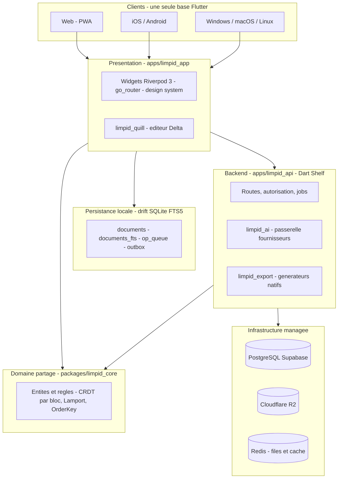
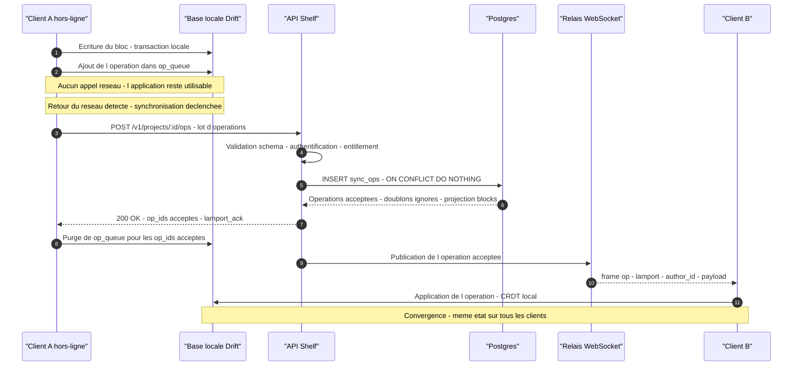
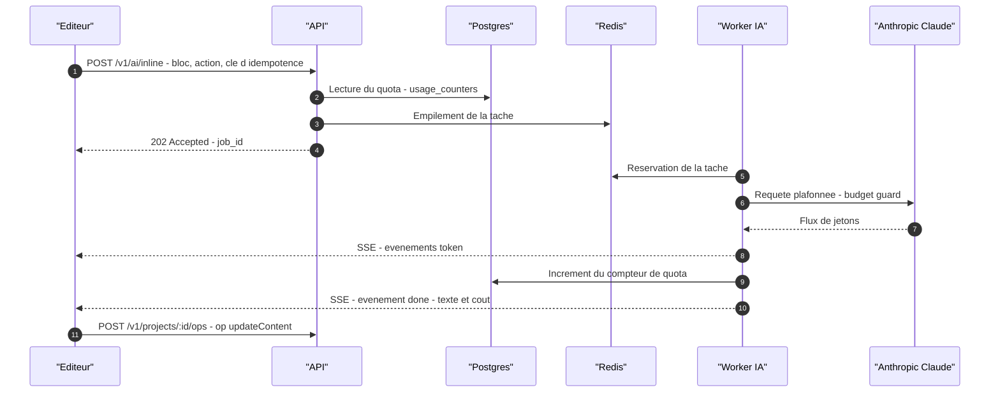
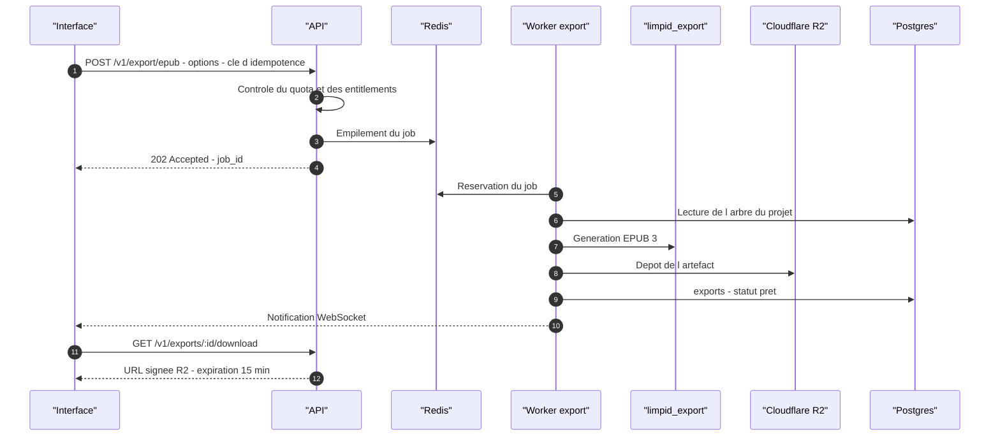
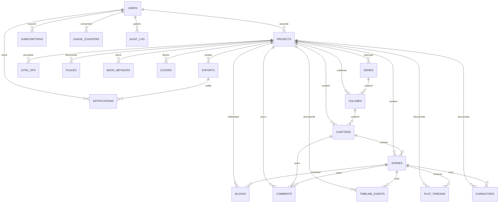
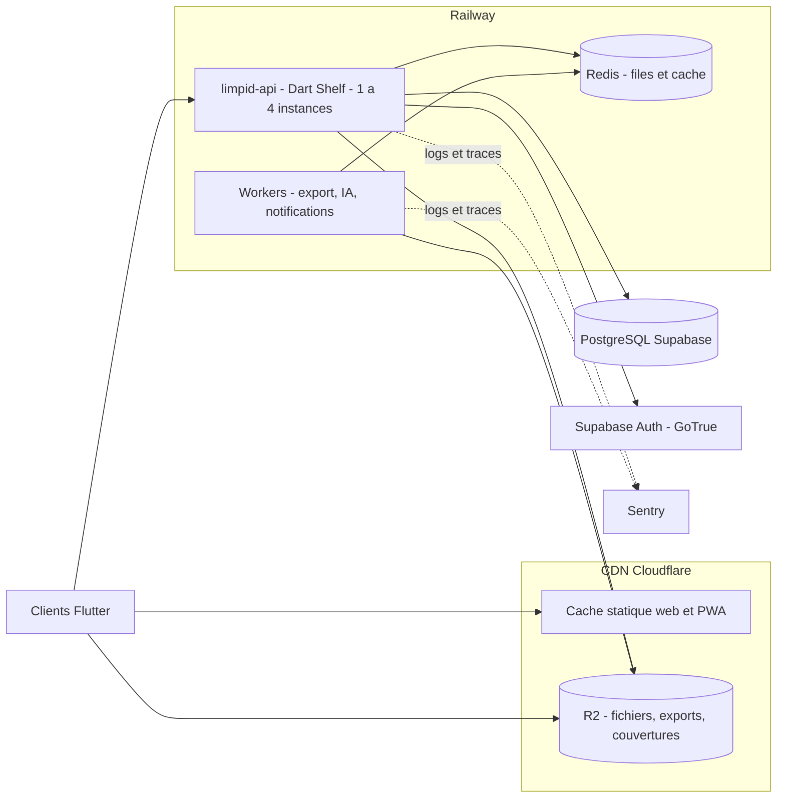

# Limpid — Architecture

> Document normatif : structure technique, protocoles de synchronisation et
> d'API, topologie de déploiement, sécurité, budgets de performance, coûts.
>
> Le socle est figé par [`DECISIONS.md`](./DECISIONS.md) (D-01 à D-25). Ce document
> **met en œuvre** ces décisions ; il ne les remplace pas. Documents liés :
> [`PROMPT.md`](./PROMPT.md), [`FEATURE_MATRIX.md`](./FEATURE_MATRIX.md),
> [`ROADMAP.md`](./ROADMAP.md). **Version** : 1.0 — 2026-10-25.


## Sommaire

| # | Section | Contenu |
|---|---|---|
| 1 | [Principes directeurs](#1-principes-directeurs) | Invariants non négociables |
| 2 | [Vue d'ensemble et couches](#2-vue-densemble-et-couches) | Architecture globale, dépendances |
| 3 | [Flux principaux](#3-flux-principaux) | Synchronisation, action IA, export |
| 4 | [Modèle de données](#4-modèle-de-données) | ERD Postgres, modèle local Drift |
| 5 | [Protocole de synchronisation](#5-protocole-de-synchronisation) | Opérations, Lamport, compaction, conflits |
| 6 | [Contrat API](#6-contrat-api) | REST, WebSocket, erreurs, pagination |
| 7 | [Topologie de déploiement](#7-topologie-de-déploiement) | Composants, hébergement, observabilité |
| 8 | [Sécurité](#8-sécurité) | Couches de contrôle, RGPD |
| 9 | [Budgets de performance](#9-budgets-de-performance) | Chiffres cibles |
| 10 | [Modes de défaillance et reprise](#10-modes-de-défaillance-et-reprise) | Réseau, quota, schéma |
| 11 | [Coûts d'exploitation](#11-coûts-dexploitation) | Ordres de grandeur par tranche |


## 1. Principes directeurs

| # | Principe | Règle appliquée | Origine |
|---|---|---|---|
| P1 | Hors-ligne d'abord | Aucune écriture, relecture, recherche ou commentaire ne dépend du réseau. | PROMPT §2, D-05 |
| P2 | Source de vérité locale | SQLite/Drift sert l'affichage hors-ligne ; Postgres sert la convergence multi-appareils. | D-05 |
| P3 | Convergence sans arbitrage | Le CRDT par bloc élimine le « dernier arrivé gagnant » ; aucun conflit n'est tranché par l'horloge murale. | D-04 |
| P4 | Un seul code | Les six cibles partagent `apps/limpid_app`. Aucune branche par plateforme. | D-03 |
| P5 | Domaine partagé | `packages/limpid_core` est le contrat de convergence entre le client et l'API. Dart pur, jamais de `package:flutter/*`. | D-03, PROMPT §5 |
| P6 | API sans état | L'API est stateless ; tout état vit dans Postgres et Redis. | D-03 |
| P7 | Localisation d'abord | Aucun texte utilisateur codé en dur ; clés dans `l10n/`. | D-17 |
| P8 | Accessibilité par défaut | WCAG 2.2 AA est une contrainte de conception, pas une passe finale. | D-18 |
| P9 | Zéro secret en dépôt | Secrets par variables d'environnement ; validation au démarrage de l'API. | D-19 |
| P10 | Test dans la livraison | Toute fonctionnalité est mergée avec ses tests ; le fuzz de convergence bloque la CI. | D-20 |

### 1.1 Règle de dépendance

La règle de dépendance de PROMPT §5 est appliquée par l'analyseur du monorepo
(`very_good analysis` et règles d'imports maison) :

| Package | Dépendances autorisées | Interdit |
|---|---|---|
| `limpid_core` | aucune (Dart pur) | `package:flutter/*`, tout package applicatif |
| `limpid_design_system` | `flutter`, `limpid_core` (types seulement) | `limpid_api` |
| `limpid_quill` | `flutter`, `limpid_core` | dépendance dure au design system |
| `limpid_ai`, `limpid_export`, `limpid_sync` | `limpid_core` | `flutter`, accès direct à Postgres |
| `limpid_app` | tous les packages clients | accès direct à Postgres ou Redis |
| `limpid_api` | `limpid_core`, `limpid_ai`, `limpid_export` | `flutter` |

À l'intérieur de `limpid_app`, la même règle vaut entre les couches :

| Couche | Rôle | Dépendances autorisées |
|---|---|---|
| `lib/src/domain/` | Les **contrats** : `ManuscriptRepository`, `SyncRepository`, `ExportRepository`, `AiRepository`, `GdprRepository`, `PublicationRepository`, l'enum `SyncStatus`, et le vocabulaire des **erreurs** | `limpid_core` uniquement |
| `lib/src/data/` | Les **implémentations** : base SQLite (Drift), client API, synchronisation, doublures en mémoire | `lib/src/domain/`, `limpid_sync`, `limpid_ai`, `drift`, `http` |
| `lib/src/features/` | Les **écrans** | `lib/src/domain/`, `limpid_design_system`, `limpid_quill` |

Les écrans ne connaissent **jamais** l'implémentation : ils dépendent des
interfaces de `lib/src/domain/`. C'est ce qui permet d'écrire les tests d'un
écran avec un dépôt factice, sans base de données ni réseau, et c'est ce qui
permet à l'application de décider, au démarrage, entre le mode local et le
mode connecté.

Le point de composition — l'endroit où les implémentations sont fournies aux
contrats — est unique et explicite : `lib/src/app/dependencies.dart`.


## 2. Vue d'ensemble et couches

L'application est **local-first** : le client possède l'état d'écriture et
d'affichage, le serveur possède la convergence et les traitements longs (IA,
export, distribution). Le client est un émetteur d'opérations, jamais un simple
cache du serveur. Un seul code Flutter cible le web (PWA), iOS, Android,
Windows, macOS et Linux.



| Couche | Package | Responsabilité | Ne fait jamais |
|---|---|---|---|
| Présentation | `apps/limpid_app` | Écrans, navigation, providers Riverpod, i18n, accessibilité | Logique métier, SQL |
| Composants | `limpid_design_system` | Tokens, 4 thèmes, widgets de base, goldens | Connaître l'éditeur |
| Éditeur | `limpid_quill` | Éditeur Delta, sérialisation Delta ↔ bloc CRDT | Connaître le réseau |
| Domaine | `limpid_core` | Entités, CRDT, sérialisation, règles métier pures | Dépendance Flutter, toute I/O |
| Synchronisation | `limpid_sync` | Transport HTTP et WebSocket, file d'opérations, reprise | Implémenter le CRDT |
| IA et export | `limpid_ai`, `limpid_export` | Fournisseurs IA et budgets ; EPUB, PDF, DOCX, HTML, Markdown, ODT | Connaître l'UI ou le compte client |
| Serveur | `apps/limpid_api` | Auth, autorisation, persistance, jobs, webhooks | Logique d'interface |


## 3. Flux principaux

### 3.1 Synchronisation : client hors-ligne vers les autres clients

Le client empile ses opérations dans `op_queue` (SQLite) et les pousse quand le
réseau est disponible. Le serveur les journalise dans `sync_ops`, projette
l'état matérialisé dans `blocks`, puis les relaie aux autres clients connectés.



| Chemin | Budget | Commentaire |
|---|---|---|
| Frappe → affichage local | 0 ms réseau | Écriture locale d'abord |
| Frappe → autres clients en ligne | < 300 ms p95 | Exigence D-16 |
| Op locale → acquittement serveur | < 800 ms p95 | Hors-ligne : pas de borne basse |
| Retour réseau → file vidée | < 30 s pour 1 000 opérations | Débit cible 40 op/s |
| Reprise après coupure longue | Toutes les ops accumulées, ordre de Lamport | Jamais de perte ni de doublon |

### 3.2 Séquence d'une édition IA

L'appel IA est asynchrone et budgété : le client ne bloque pas l'éditeur, le
serveur plafonne la dépense avant d'appeler le fournisseur.



### 3.3 Séquence d'un export




## 4. Modèle de données

Postgres est la source de vérité multi-appareils. Le modèle respecte la
hiérarchie à 5 niveaux de D-02 : `projects > series > volumes > chapters >
scenes`. La scène est l'unité atomique de synchronisation ; les blocs sont la
matérialisation du CRDT.

### 4.1 Schéma Postgres



Colonnes clés par table :

| Table | Colonnes clés | Contrainte notable |
|---|---|---|
| `users` | `id`, `email`, `display_name`, `plan`, `two_factor_enabled`, `deleted_at` | `email` unique |
| `projects` | `id`, `owner_id`, `title`, `status`, `language`, `word_count`, `is_public` | index sur `owner_id` |
| `series` | `id`, `project_id`, `title`, `position` | `position` unique par projet |
| `volumes` | `id`, `project_id`, `series_id`, `title`, `position` | `series_id` nullable |
| `chapters` | `id`, `project_id`, `volume_id`, `title`, `status`, `position` | `volume_id` nullable |
| `scenes` | `id`, `project_id`, `chapter_id`, `pov_character_id`, `title`, `position`, `word_count`, `lamport` | `pov_character_id` nullable |
| `blocks` | `id`, `scene_id`, `parent_id`, `doc_id`, `order_key`, `type`, `content`, `marks`, `lamport`, `author_id`, `deleted`, `version` | `content` et `marks` en `jsonb` |
| `sync_ops` | `id`, `project_id`, `doc_id`, `lamport`, `author_id`, `type`, `payload`, `schema_version`, `created_at` | unique sur `(doc_id, lamport, author_id)` |
| `comment_threads` | `id`, `project_id`, `mark_id`, `excerpt`, `is_resolved`, `created_at`, `updated_at`, `resolved_at` | index sur `(project_id, created_at)` |
| `comments` | `id`, `thread_id`, `author_id`, `body`, `created_at`, `edited_at` | index sur `(thread_id, created_at)` |
| `characters` | `id`, `project_id`, `kind`, `name`, `summary`, `attributes`, `arcs` | `kind` : personnage, objet, organisation |
| `places` | `id`, `project_id`, `name`, `summary`, `attributes` | — |
| `plot_threads` | `id`, `project_id`, `title`, `status`, `resolution`, `scene_ids` | `scene_ids` en `jsonb` |
| `timeline_events` | `id`, `project_id`, `scene_id`, `title`, `occurs_at`, `story_order`, `description` | `occurs_at` textuel ou ISO |
| `book_metadata` | `id`, `project_id`, `isbn`, `bisac`, `language`, `rights_holder`, `contributors`, `description`, `published_at` | `isbn` unique par projet |
| `covers` | `id`, `project_id`, `kind`, `r2_key`, `width`, `height`, `prompt` | `r2_key` jamais public |
| `exports` | `id`, `project_id`, `format`, `status`, `r2_key`, `size_bytes`, `options`, `error_code`, `requested_at`, `completed_at` | `status` : en cours, pret, echec |
| `subscriptions` | `id`, `user_id`, `plan`, `status`, `stripe_customer_id`, `stripe_subscription_id`, `seats`, `current_period_end`, `cancel_at_period_end` | une ligne active par utilisateur |
| `usage_counters` | `id`, `user_id`, `feature`, `period_start`, `period_end`, `units`, `limit_units` | unique sur utilisateur, fonctionnalité, période |
| `audit_log` | `id`, `user_id`, `action`, `target_type`, `target_id`, `metadata`, `ip`, `created_at` | en écriture seule |
| `notifications` | `id`, `user_id`, `kind`, `title`, `body`, `read_at`, `created_at` | `read_at` nullable |

Notes de lecture : `blocks` est l'état **matérialisé** du CRDT, projeté depuis
`sync_ops` ; il porte `author_id`, `deleted` (tombstone, suppression réversible)
et `version`. `sync_ops` est le journal **append-only** ; la contrainte
d'unicité `(doc_id, lamport, author_id)` porte l'idempotence (§5.3). `doc_id`
identifie le document de synchronisation ; en v1 il vaut l'identifiant de la
scène (D-02). La taxonomie objets et organisations de O2 est portée par
`characters.kind`. `usage_counters` porte les quotas de D-08 et D-15 ;
`audit_log` trace export, partage, suppression et changement de plan (D-19).
Les discussions sont **normalisées** : `comment_threads` porte l'ancrage
(`mark_id`, `excerpt`) et l'état de résolution, `comments` porte le texte des
messages. Un fil est donc résolu d'un seul geste, et l'ancrage survit à la
réécriture du texte qu'il désigne.
Toutes les tables métier portent `deleted_at` : soft delete 30 jours (D-19).

### 4.2 Modèle local Drift

SQLite, un seul fichier (`limpid.db`), une seule connexion. Les tables de
l'application sont du **SQL écrit à la main** (`lib/src/data/app_schema.dart`,
D-27 : la couche doit compiler sans `build_runner`) ; les tables de la
synchronisation sont créées par Drift lui-même.

| Table | Rôle | Index | Durée de vie |
|---|---|---|---|
| `projects` | Racine du manuscrit : titre, synopsis, état, identifiants des séries et des chapitres | `(updated_at DESC, id)` | Persistant |
| `chapters` | Chapitre d'un projet : titre, synopsis, état, position fractionnaire | `(project_id, order_key)` | Persistant |
| `series` | Série d'un projet : le premier niveau de la hiérarchie, avec la liste ordonnée de ses tomes | `(project_id, order_key)` | Persistant |
| `volumes` | Tome d'une série : le deuxième niveau, avec la liste ordonnée de ses chapitres | `(series_id, order_key)` | Persistant |
| `scenes` | Scène d'un chapitre : titre, document CRDT, position fractionnaire | `(chapter_id, order_key)` | Persistant |
| `document_index` | Index de routage : à quel projet appartient un document synchronisé | `(project_id)` | Persistant |
| `comment_threads` | Fil de discussion ancré sur un document | `(project_id)` | Persistant |
| `comments` | Message d'un fil de discussion | `(thread_id)` | Persistant |
| `sync_cursors` | Curseur de synchronisation par projet | — | Persistant |
| `project_members` | Collaborateurs d'un projet et rôle : la bibliothèque est cloisonnée par compte | `(project_id, user_id)` | Persistant |
| `preferences` | Objectif quotidien, série de jours d'écriture | — | Persistant |
| `op_queue_rows` | Opérations CRDT non acquittées, ordre de Lamport (Drift, `limpid_sync`) | clé primaire `(doc_id, lamport, author_id)` | Purgée à l'acquittement |
| `snapshot_rows` | Journal compacté des documents et curseur de l'API (Drift, `limpid_sync`) | `(document_id)` | Persistant |
| `documents_fts` | Index plein texte FTS5 : le texte des blocs, avec la scene, le livre et le compte | FTS5 (`unicode61`, sans diacritiques) | Persistant |
| `search_index_state` | Ce que l'index porte deja, par document : la date et la Lamport du dernier indexage | clé primaire `(account_id, document_id)` | Persistant |

La **recherche plein texte** est **locale** : elle lit l'index FTS5 de
l'appareil, jamais le reseau — c'est la promesse du produit. L'index est
une table virtuelle FTS5 (`documents_fts`), alimentee par la couche de
donnees et **rapproche** de la source avant chaque recherche : un bloc
modifie est retrouve avec son nouveau texte, un bloc supprime disparait.
`search_index_state` dit, pour chaque document, ce que l'index porte
 deja, afin qu'une recherche ne relise pas un document qui n'a pas bouge.

La file des effets de bord hors-ligne (`outbox`) n'est pas encore ecrite :
elle fait partie du lot 4.

### 4.3 Persistance de l'API : deux moteurs, un seul port

L'API ne parle jamais directement à un moteur SQL. Trois implémentations
existent derrière les mêmes interfaces (`ProjectStore`, `SyncStore`,
`AuditLog`) :

| Implémentation | Usage | Fichier |
|---|---|---|
| `PostgresProjectStore` et al. | Production (Supabase managé) | `apps/limpid_api/lib/src/db/postgres_*.dart` |
| `SqliteProjectStore` et al. | Développement par défaut (D-29) | `apps/limpid_api/lib/src/db/sqlite_*.dart` |
| `InMemoryProjectStore` et al. | Tests unitaires, sans base du tout | `apps/limpid_api/lib/src/db/in_memory_*.dart` |

Le moteur se choisit par `LIMPID_DB_DRIVER` :

| Variable | Valeur | Défaut | Rôle |
|---|---|---|---|
| `LIMPID_DB_DRIVER` | `sqlite` \| `postgres` | `sqlite` | Moteur de persistance de l'API |
| `LIMPID_DB_PATH` | chemin de fichier | `.limpid/limpid.db` | Base SQLite de développement |
| `DATABASE_URL` | URL de connexion | — | **Requis uniquement** si le pilote est `postgres` |

Les migrations sont doublées par dialecte — `db/migrations/*.sql` pour
Postgres, `db/migrations/sqlite/*.sql` pour SQLite — et doivent rester
équivalentes : mêmes tables, mêmes colonnes, mêmes index, mêmes unicités.

Le dialecte est **confiné aux adaptateurs**. Aucun `TIMESTAMPTZ`, aucun
`JSONB`, aucun `ILIKE` ne franchit la frontière d'un `lib/src/db/`. Les
différences réelles entre les deux moteurs sont listées dans D-29.

La garantie qui compte : **les scénarios de dépôt sont exécutés contre les
deux implémentations**. Un test qui ne passe que sur l'un des deux moteurs est
un bug, pas une différence de dialecte.

### 4.4 Tables livrées du lot 7

Les tables que le lot 7 a ajoutées à l'API, dans les deux dialectes :

| Table | Colonnes | Rôle |
|---|---|---|
| `account_plans` | `user_id`, `plan`, `billing_period`, `trial_ends_at`, `period_started_at`, `period_ends_at` | La formule d'un compte et sa période |
| `quota_usage` | `user_id`, `feature`, `period_key`, `quantity` | La consommation, par fonctionnalité et par période |
| `two_factor` | `user_id`, `secret`, `is_enabled`, `created_at`, `enabled_at` | Le secret TOTP d'un compte |
| `two_factor_recovery_codes` | `user_id`, `code_hash`, `used_at` | Les codes de récupération, **par empreinte** |
| `teams` | `id`, `name`, `owner_id`, `created_at`, `updated_at` | Une équipe |
| `team_members` | `team_id`, `user_id`, `role`, `created_at` | Un membre et son rôle d'équipe |
| `team_invitations` | `id`, `team_id`, `user_id`, `role`, `invited_by`, `created_at` | Une invitation en attente |
| `feature_flags` | `flag_key`, `is_enabled`, `description`, `updated_at`, `updated_by` | Un indicateur de fonctionnalité |
| `api_keys` | `id`, `user_id`, `name`, `key_hash`, `scopes`, `is_active`, `created_at`, `rotated_at`, `revoked_at`, `last_used_at` | Une cle d'API, jamais en clair |
| `webhook_endpoints` | `id`, `user_id`, `url`, `events`, `secret`, `previous_secret`, `previous_secret_expires_at`, `is_active`, `created_at`, `updated_at` | Un point de rappel et son secret de signature |
| `webhook_deliveries` | `id`, `endpoint_id`, `user_id`, `event`, `payload`, `status`, `http_status`, `error_message`, `attempts`, `created_at`, `completed_at` | Une livraison et son issue |
| `kdp_publications` | 21 colonnes : projet, compte, titre, auteur, résumé, mots-cles, catégories, ISBN, langue, statut, mots, pages, clés des fichiers | Le dossier préparé pour Amazon |
| `account_purges` | `user_id`, `requested_at`, `scheduled_for`, `purged_at`, `purged_by` | Le registre des purges : la preuve qu'une suppression a eu lieu, et le verrou d'idempotence |
| `account_purge_deletions` | `user_id`, `target`, `deleted_at`, `deleted_count`, `attempts`, `last_error`, `updated_at` | La suppression externe d'un compte, cible par cible |
| `account_purge_artifacts` | `user_id`, `prefix`, `deleted_at`, `deleted_count`, `created_at` | Les préfixes d'artefacts d'un compte, écrits avant l'effacement |
| `stripe_events` | `event_id`, `event_type`, `processed_at` | Les événements Stripe déjà traités : la clé d'idempotence du rappel de paiement |
| `kdp_deposits` | `id`, `publication_id`, `user_id`, `status`, `amazon_submission_id`, `issues`, `failure_reason`, `attempts`, `created_at`, `updated_at` | La trace d'un dépôt de dossier chez Amazon |

Elles remplissent les tables `subscriptions` et `usage_counters` prevues au
schema cible (§4.1) : les noms retenus sont plus courts, et les colonnes
répondent à ce que l'implémentation fait vraiment — la date de fin d'essai,
par exemple, n'a de sens que parce qu'un abonnement n'est confirmé qu'après
le paiement.

Les **secrets** ne sont jamais stockés en clair : le secret TOTP est en
base32 et les codes de récupération ne sont gardés que par empreinte
SHA-256. Une fuite de la base ne donne donc aucun code utilisable.

### 4.5 La portée de la purge

La purge efface **toutes** les données personnelles d'un compte, et la
portée est **déclarée dans le code**, pas dans un commentaire :
`db/personal_data_tables.dart` liste les tables effacées, celles dont un
champ est vidé, et celles qui sont gardées avec la raison de les garder.

Un test compare cette déclaration au schéma : une table personnelle
ajoutée plus tard et non déclarée fait échouer la suite. C'est la réponse
au trou que le lot 7 a laissé — la purge n'effaçait que les tables
d'avant le lot 7, et le secret TOTP comme les secrets de signature des
webhooks restaient en base après une suppression promise.

Trois tables sont **gardées**, et la raison est écrite :

| Table | Pourquoi |
|---|---|
| `audit_log` | Le journal d'audit est conservé un an (D-19). Il porte les actions, l'adresse et l'expérience du compte, **pas** le texte des livres. |
| `account_purges` | Le registre qui prouve la purge et verrouille son idempotence. |
| `stripe_events` | L'identifiant de l'événement traité : la clé d'idempotence du rappel de paiement. Aucune donnée personnelle. |

### 4.6 Les tables livrées par le lot 8

Le lot 8 a ajouté les tables que les lots 4 à 6 promettaient sans les
porter. Elles existent dans les **deux** dialectes, et le vérificateur
`.limpid/verifier_dialectes.py` les compare table par table :

| Table | Rôle |
|---|---|
| `project_shares` | Un partage en lecture : le projet, le propriétaire, l'**empreinte** du jeton, l'expiration, la révocation. Le jeton en clair n'est jamais stocké. |
| `book_sales` | La fiche de vente d'un livre : le prix, la devise, l'état, la part de l'auteur et celle de la plateforme. |
| `entitlements` | Le droit de lecture d'un compte sur un livre : la source (vente, code promo, gratuité), le montant, et la **ventilation** des sommes entre l'auteur et la plateforme. |
| `promo_codes` | Un code promo : sa remise, son nombre d'utilisations, sa période de validité. |
| `series` | Une série : le premier niveau de la hiérarchie du livre (projet → série → tome → chapitre → scène). |
| `volumes` | Un tome : le deuxième niveau, avec ses chapitres. |

Deux **index uniques** ferment des fenêtres que le service seul ne ferme
pas : `kdp_publications (project_id)` — une fiche Amazon KDP par projet —
et `kdp_publications (isbn)` — un ISBN ne désigne qu'un ouvrage imprimé,
même quand deux préparations concurrentes passent entre le contrôle et
l'écriture.


## 5. Protocole de synchronisation

Le moteur est implémenté dans `packages/limpid_core/src/sync/`. Aucun autre
algorithme n'est autorisé (PROMPT §6). Cette section décrit le format de
transport ; les règles de résolution sont fixées par D-04.

### 5.1 Format d'opération

```json
{ "op_id": "01J8ZQ7M4K2P9V3X8Y6B1T0NC5",
  "doc_id": "01J8ZQ3A1B2C3D4E5F6G7H8J9K", "lamport": 128,
  "author_id": "01J8ZQ0P5R6S7T8U9V0W1X2Y3Z", "type": "updateContent",
  "payload": { "block_id": "01J8ZQ5D3E4F5G6H7J8K9L0M1N",
               "content": "Il pleuvait sur la falaise.", "base_version": 41 },
  "schema_version": 1, "client_ts": "2026-10-25T09:12:33.412Z" }
```

`op_id` (ULID unique) sert à la déduplication réseau, `doc_id` désigne le
document synchronisé (la scène en v1), `lamport` est l'horloge logique qui
arbitre le LWW, `author_id` départage à Lamport égal, `type` désigne la nature
de l'opération (§5.2), `payload` porte les données, `schema_version` date la
version du protocole (§5.7) et `client_ts` ne sert qu'à l'observabilité, jamais
à l'arbitrage.

### 5.2 Types d'opérations

| Type | Charge utile | Règle de conflit appliquée (D-04) |
|---|---|---|
| `insertBlock` | `block_id`, `parent_id`, `order_key`, `type`, `content` | Position : index fractionnaire, comparaison lexicographique |
| `deleteBlock` | `block_id` | Tombstone ; l'emporte si `lamport(delete) > lamport(modif)`, sinon le bloc renaît |
| `updateContent` | `block_id`, `content`, `base_version` | Fusion 3-way par plus long préfixe et suffixe commun |
| `moveBlock` | `block_id`, `parent_id`, `order_key` | Position : index fractionnaire |
| `setMeta` | `target`, `key`, `value` | LWW sur Lamport, égalité départagée par `author_id` |
| `addMark`, `removeMark` | `block_id`, `mark_id`, `range`, `payload` | Union additive, jamais de conflit |

### 5.3 Lamport, causalité et idempotence

- **Horloge.** À l'émission locale : `lamport = max(lamport connus) + 1`. À la
  réception d'une opération distante : `lamport = max(lamport local, lamport
  reçu) + 1`. La valeur est persistée dans `documents.lamport`. Aucun ordre
  global de livraison n'est requis : l'application suit l'ordre de Lamport local
  et absorbe les opérations antérieures.
- **Idempotence structurelle.** La contrainte d'unicité
  `(doc_id, lamport, author_id)` sur `sync_ops` rend la ré-application sans
  effet ; le serveur répond `200` avec les `op_id` acceptés, doublons compris.
- **Idempotence réseau.** `op_id` distingue « opération déjà appliquée » de
  « opération perdue » : un lot renvoyé en partie est repris sans dupliquer.
- **LWW déterministe.** À Lamport égal, le plus grand `author_id` gagne : la
  règle est totalement ordonnée, tous les clients convergent.

### 5.4 Compaction et instantanés

| Paramètre | Valeur | Rôle |
|---|---|---|
| Seuil de compaction | 500 opérations par document | Déclenche le calcul d'un instantané |
| Seuil de volume | 2 Mo de charge utile cumulée | Second déclencheur, pour les documents texte |
| Rétention du journal | 30 jours | Après purge, archive froide compressée dans R2 |
| Fréquence de l'archive | quotidienne | Instantané complet par document modifié |

Un instantané contient l'état CRDT complet : blocs et tombstones, Lamport
maximale, liste des auteurs connus, version de schéma. Il est écrit dans
`blocks` et référencé par `projects.snapshot_lamport` ; les opérations
antérieures sont purgées de `sync_ops`, et un client dont la Lamport est
inférieure reçoit l'instantané au lieu du journal.

### 5.5 Résolution de conflit

Reprise des règles de D-04, appliquées par le même code sur le client et le
serveur (`limpid_core`) :

| Conflit | Règle appliquée | Effet utilisateur |
|---|---|---|
| Déplacement concurrent d'un bloc | Index fractionnaire, comparaison lexicographique | Aucun : les deux positions coexistent, ordre stable |
| Texte du même paragraphe modifié concurremment | Fusion 3-way (plus long préfixe et suffixe commun) | Les deux apports sont conservés, ligne par ligne |
| Métadonnée scalaire (titre, statut) | LWW sur Lamport, égalité départagée par `author_id` | La dernière valeur logique gagne, identiquement partout |
| Marques (commentaires, notes IA) | Union additive | Aucun conflit possible |
| Suppression contre modification | La suppression l'emporte si `lamport(delete) > lamport(modif)`, sinon le bloc renaît | Suppression réversible |

La fuzz multi-agents de D-20 (2 rédacteurs et 1 relais, ordre de livraison
aléatoire) est la preuve bloquante de cette convergence.

### 5.6 Reprise après coupure

1. Le client reste utilisable : les opérations s'empilent dans `op_queue`, puis
   sont envoyées par lots de 200 dans l'ordre de Lamport croissant au retour du
   réseau.
2. Le serveur acquitte les `op_id` acceptés ; le client purge `op_queue`. Un
   lot refusé (`schema_version_unsupported`, charge utile invalide) est isolé
   dans `op_queue.state = 'rejected'` ; la file continue sans blocage.
3. Après le push, un `GET /v1/projects/:id/ops?since=` rattrape ce qui a été
   manqué pendant la coupure.

### 5.7 Dérive de schéma

| Élément | Valeur |
|---|---|
| Version courante | `SyncProtocol.schemaVersion = 1`, constante de `limpid_core` |
| Version minimale acceptée | `minSupportedSchemaVersion = 1` |
| Opération trop ancienne | `409 schema_version_unsupported` |
| Opération en avance | `426 client_ahead` |

- **Opération compatible** : journalisée et appliquée normalement. **Version
  inconnue du serveur** : stockée dans `sync_ops` avec l'état
  `pending_migration`, non projetée dans `blocks`, sans erreur ; le document est
  servi dans son état projeté, aucun crash.
- **Client en retard** : `409` avec `details.min_supported`. Le client applique la
  migration prévue dans `limpid_core` (fonction pure `migrate(old, new)`) et
  réémet. Si la migration est hors de portée, il déclenche une
  **resynchronisation complète** : purge des documents locaux, puis
  `GET /v1/projects/:id/tree` pour reconstruire l'état depuis le serveur.
- **Client en avance** : `426`. Le client refuse d'envoyer et propose la mise à
  jour de l'application ; aucune donnée n'est perdue en local.


## 6. Contrat API

### 6.1 Conventions

| Convention | Règle |
|---|---|
| Préfixe | Toutes les routes métier sous `/v1` |
| Format | JSON `snake_case`, requêtes et réponses |
| Enveloppe | Toute réponse de succès est `{ "data": … }` ; toute erreur est `{ "error": { "code", "message", "details" } }` |
| Auth | `Authorization: Bearer <jwt>`, JWT Supabase Auth validé via JWKS |
| Horodatage | ISO 8601 UTC, suffixe `Z` |
| Identifiant | ULID, 26 caractères |
| Langue | `Accept-Language` ; messages d'erreur en français, `code` stable |
| Corps et lot | 4 Mo par requête ; 200 opérations maximum par `POST .../ops` ; imports et exports passent par R2 |
| Pagination | Curseur opaque, `limit` par défaut 50 et maximum 200, tri `updated_at` décroissant puis `id` ; réponse `items`, `next_cursor`, `has_more` |
| Non paginable | Arbre d'un projet, lot d'opérations, corps de requête IA |

> **L'enveloppe est une convention stricte.** Un client qui lit les champs au
> niveau racine ne les trouve jamais : `HttpSyncTransport` en
> `packages/limpid_sync` déballe donc le `data` une fois pour toutes, à
> l'interface avec le serveur. C'est le seul endroit du dépôt qui connaît
> cette forme.

### 6.2 Points d'entrée

| Famille | Méthodes et routes | Rôle | Lot |
|---|---|---|---|
| Authentification | `POST /v1/auth/session`, `POST /v1/auth/refresh`, `DELETE /v1/auth/session`, `GET /v1/auth/me` | Magic link, OAuth, rotation, révocation, profil | 0 |
| Sessions | `GET /v1/sessions`, `DELETE /v1/sessions/:id` | Appareils connectés et révocation | 0 |
| Projets | `GET, POST /v1/projects`, `GET, PATCH, DELETE /v1/projects/:id` | Liste paginée, création, détail, mise à jour, soft delete | 1 |
| Structure | `GET, POST, PATCH, DELETE /v1/projects/:id/{series,volumes,chapters,scenes}` | Hiérarchie à 5 niveaux | 1 |
| Story Bible | `GET, POST, PATCH, DELETE /v1/projects/:id/{characters,places,plot-threads,timeline-events}` | Personnages, lieux, arcs, chronologie | 1 |
| Synchronisation | `GET /v1/projects/:id/tree`, `POST /v1/projects/:id/ops`, `GET /v1/projects/:id/ops?since=` | Reconstruction, push, pull | 2 |
| Commentaires | `GET, POST /v1/projects/:id/threads`, `GET /v1/projects/:id/members` | Fils de discussion ancrés et collaborateurs | 3 |
| IA | `POST /v1/ai/generate`, `/v1/ai/inline`, `/v1/ai/query`, `/v1/ai/analyze`, `/v1/ai/cover` | Génération, action en ligne, RAG, analyse, couverture | 4, 5 |
| Exports | `POST /v1/export/:format`, `GET /v1/exports`, `GET /v1/exports/:id`, `GET /v1/exports/:id/download` | Exports et URL signée | 5 |
| Vitrine | `GET /v1/public/books/:projectId`, `GET /v1/public/authors/:id` | Pages publiques et catalogue | 6 |
| Vente | `POST /v1/checkout`, `GET /v1/checkout/:session_id`, `POST /v1/publishing/kdp` | Paiement Stripe et soumission KDP | 6 |
| Facturation | `GET /v1/billing/usage`, `GET, POST /v1/billing/subscription` | Quotas, plan et période | 7 |
| Administration | `POST /v1/admin/users`, `PATCH /v1/admin/flags` | Back-office, indicateurs, webhooks sortants | 7 |
| Données | `GET /v1/me/export`, `DELETE /v1/me` | Export RGPD et suppression du compte | 7 |
| Temps réel | `WS /v1/sync`, `WS /v1/notifications` | Relais d'opérations et notifications | 2, 5 |

Les routes du lot 7 sont livrées sous les noms que porte l'implémentation :
`GET /v1/me/plan`, `GET /v1/me/quota`, `GET /v1/plans` pour les formules et
les quotas ; `GET, POST /v1/teams`, `GET /v1/teams/:teamId/members`,
`POST /v1/teams/:teamId/invitations`,
`PATCH, DELETE /v1/teams/:teamId/members/:userId`, `DELETE /v1/teams/:teamId`
pour les equipes ; `GET /v1/me/2fa`, `POST /v1/me/2fa/enroll`,
`POST /v1/me/2fa/confirm`, `POST /v1/me/2fa/verify`, `DELETE /v1/me/2fa`
pour la double authentification ; `GET /v1/admin/users`,
`GET /v1/admin/users/:userId`, `GET /v1/admin/feature-flags`,
`PUT /v1/admin/feature-flags/:key` pour le back-office.

Les quatre familles sont **facultatives** : un serveur qui ne cable pas le
port correspondant ne sert pas ses routes, plutot que de les servir en
erreur (D-36).

Trois familles de plus suivent la meme regle : `GET /v1/api/me`,
`GET /v1/api/events` et les cles d'API sous `/v1/api-keys` (l'API publique
s'authentifie par sa cle, pas par le jeton de session : le prefixe
`/v1/api/` est exempt du jeton), `/v1/webhooks/endpoints` et
`/v1/webhooks/deliveries` pour les rappels, et `POST /v1/publishing/kdp`
pour la preparation du dossier de depot Amazon. `PUT /v1/admin/plans/:userId`
attribue une formule payee : elle est reservee a l'administrateur et porte la
reference du paiement (D-37).

Le **rappel de paiement** est la porte d'entree des formules payees :
`POST /v1/stripe/webhook` verifie la signature Stripe (`t=…,v1=…`), refuse
un corps hors tolerance d'horodatage, et n'applique l'effet qu'une fois par
evenement — la table `stripe_events` porte la cle d'idempotence. Le client
ne s'attribue jamais une formule payee : c'est le rappel qui l'attribue.

Les **webhooks sortants** repartent de cinq points d'emission, et chacun
d'eux a une table : `project.published` (la transition de publication),
`export.completed` (l'artefact deposite), `plan.changed` (la formule
changee, y compris par le rappel Stripe), `team.invitation_sent` et
`quota.reached` (le refus d'une limite). La charge est **asynchrone** :
elle part en `unawaited`, ne leve jamais et journalise son echec cote
serveur. Une livraison morte ne transforme jamais l'export en erreur, et
elle se rejoue a la main par `POST /v1/webhooks/deliveries/:id/replay`. La
charge ne porte jamais le texte d'un manuscrit, ni un secret, ni la donnee
d'un autre compte ; l'URL de rappel est validee (https, hote public), donc
pas de SSRF vers un hote prive.

Le **depot chez Amazon** est une seconde etape :
`POST /v1/publishing/kdp/deposits` depose le dossier prepare,
`GET /v1/publishing/kdp/deposits` en liste les depots du compte, et
`GET /v1/publishing/kdp/deposits/:depositId` en rend la trace. Un refus
d'Amazon n'est pas une erreur technique : il revient dans la trace, avec la
forme du controle de soumission, pour que l'auteur puisse le corriger. Un
serveur sans identifiants Amazon refuse le depot et le dit (503) : il ne
pretend jamais que le livre est arrive.

Le depot lui-meme est **borne en temps** : les 28 secondes de la requete
(partagees entre le jeton et le depot) sont le budget de toute la chaine,
et l'appel qui n'a plus de temps **ne part pas**. Un dossier parti dont
Amazon n'a pas repondu passe en `unknown` : il n'est pas reprenable
automatiquement, la route repond `409` avec `requires_reconciliation`, et
c'est l'auteur qui tranche par
`POST /v1/publishing/kdp/deposits/:id/reconciliation` — `submitted` ou
`not_received`. Un compte bloque, un depot bride et un jeton refuse ont
chacun leur raison : aucun de ces messages ne dit « relancez ».

L'**export des donnees personnelles** ne rend plus les donnees : il rend
un descripteur et une **URL signee** de quinze minutes. L'archive est un
**ZIP** ecrit par le serveur, depose dans le stockage objet sous le prefixe
du compte ; l'application la telecharge par cette URL, **sans** le jeton
de session. La reponse dit ce que l'archive contient (`counts`) et ce
qu'elle n'a pas pu embarquer (`assets_omitted`) : la troncature est
annoncee, jamais cachee. La purge du compte efface l'archive avec le
reste.

### 6.3 Formes de requête et de réponse

`POST /v1/projects/:id/ops` envoie un lot d'opérations :

```json
{ "operations": [ { "op_id": "01J8ZQ7M4K2P9V3X8Y6B1T0NC5",
                    "doc_id": "01J8ZQ3A1B2C3D4E5F6G7H8J9K", "lamport": 128,
                    "author_id": "01J8ZQ0P5R6S7T8U9V0W1X2Y3Z",
                    "type": "updateContent",
                    "payload": { "block_id": "01J8ZQ5D3E4F5G6H7J8K9L0M1N",
                                 "content": "Il pleuvait sur la falaise.",
                                 "base_version": 41 }, "schema_version": 1 } ] }
```

Réponse :

```json
{ "data": { "accepted": [...], "duplicated": [], "rejected": [],
            "lamport_ack": 129 } }
```

Une opération refusée porte son identifiant quand le serveur a pu le lire :
`{ "op_id": "…", "code": "schema_version_unsupported", "message": "…" }`.
Une opération trop malformée pour être décodée n'a pas d'identifiant ; le
refus est malgré tout rapporté, sous une clé technique synthétisée
(`unknown:operations`), jamais silencieusement abandonné.

`POST /v1/ai/inline` reçoit `{ "block_id", "action", "instruction", "tone",
"max_tokens" }` et répond `200` avec `text/event-stream` : un événement `token`
par fragment, puis un événement `done` portant le texte complet et le coût en
jetons.

### 6.4 Erreurs

Enveloppe unique, alignée sur PROMPT §7 :

```json
{ "error": { "code": "quota_exceeded",
              "message": "Quota d'IA épuisé pour aujourd'hui. Réessayez demain ou changez de plan.",
              "details": { "feature": "ai_inline", "used": 2, "limit": 2,
                           "reset_at": "2026-10-26T00:00:00Z" } } }
```

`code` est stable, technique et traduisible ; `message` est en français et
destiné à l'utilisateur.

| Code | HTTP | Signification |
|---|---|---|
| `unauthorized` | 401 | Jeton absent, invalide ou expiré |
| `forbidden` | 403 | Rôle insuffisant ou ressource hors périmètre |
| `not_found` | 404 | Ressource inexistante ou masquée par isolation |
| `conflict` | 409 | Conflit métier (plan, statut, ressource occupée) |
| `idempotency_key_conflict` | 409 | Clé d'idempotence réutilisée avec un corps différent |
| `schema_version_unsupported` | 409 | Version de protocole refusée (§5.7) |
| `payload_too_large` | 413 | Corps supérieur à la limite |
| `validation_failed` | 422 | Échec de validation du schéma d'entrée |
| `quota_exceeded` | 429 | Quota de fonctionnalité épuisé (D-08) |
| `rate_limited` | 429 | Limite de débit dépassée |
| `plan_limit_reached` | 402 | Action réservée à un plan supérieur (D-15) |
| `client_ahead` | 426 | Client en avance sur le serveur |
| `ai_provider_unavailable` | 503 | Fournisseur IA indisponible ou saturé |
| `export_failed` | 500 | Échec du générateur, reprise possible |
| `internal_error` | 500 | Erreur inattendue, journalisée avec contexte |

### 6.5 Idempotence des appels à effet de bord

Les appels à effet non idempotent exigent un en-tête `Idempotency-Key`
(UUID v4) : `POST /v1/checkout`, `POST /v1/export/:format`,
`POST /v1/publishing/kdp` et les quatre routes IA. Le serveur conserve la clé
24 h dans Redis avec l'empreinte du corps : une répétition de la même clé
**avec le même corps** renvoie la réponse d'origine sans double effet, une
répétition **avec un corps différent** renvoie `409 idempotency_key_conflict`.
Les opérations CRDT n'utilisent pas ce mécanisme : elles ont déjà leur
idempotence structurelle (§5.3).

### 6.6 WebSocket

Route unique `WS /v1/sync`, sous-protocole `limpid.v1`, authentification par
jeton court au moment de l'ouverture. Trame commune :
`{ "type", "seq", "sent_at", "payload" }`, où `payload` porte une opération au
format de §5.1.

| Type | Émis par | Sens |
|---|---|---|
| `hello` | serveur | Prise de contact, identité du client |
| `join`, `leave` | client | Abonnement à une salle `(projet, document)` |
| `op` | serveur ou client | Opération CRDT |
| `cursor` | client | Position du curseur de l'auteur, `block_id` et `offset` |
| `ack` | serveur | Acquittement d'une opération reçue |
| `presence` | serveur | Curseurs distants, avatars (C2) |
| `error` | serveur | Erreur applicative, `code` stable |
| `ping`, `pong` | les deux | Garde-fou, 25 s d'inactivité |

Le relais ne modifie jamais le contenu d'une opération : il la transmet. La
convergence reste la propriété du CRDT (D-04).

La présence appartient au relais : il annonce les jonctions, les positions
des curseurs et les départs, et il purge le pair qui cesse de battre (30 s
sans réponse au `ping`). Le client n'annonce jamais son départ : il cesse de
battre, et le relais le retire de la salle.


## 7. Topologie de déploiement



| Composant | Hébergement | Dimensionnement de départ | Remarque |
|---|---|---|---|
| `apps/limpid_app` web | Statique servi par CDN Cloudflare | Build de 8 à 15 min | PWA ; le service worker ne cache que le shell (D-22) |
| `apps/limpid_app` mobile et desktop | Stores et installeurs | — | Même code Flutter (D-03) |
| `apps/limpid_api` | Railway, service Dart | 1 instance 2 vCPU / 4 Go, extensible à 4 | Sans état, montée en charge horizontale |
| Workers export, IA, notifications | Railway, services Dart | 2 vCPU / 4 Go pour l'export et l'IA, 1 vCPU / 1 Go pour les notifications | EPUB et PDF vers R2, appels fournisseurs, WebSocket |
| PostgreSQL | Supabase managé | Plan Pro, pooler activé | Sauvegarde quotidienne vers R2, PITR 7 jours |
| Redis | Railway ou Upstash managé | 1 Go | Files d'attente, idempotence, cache court |
| R2 | Cloudflare | — | Sortie réseau sans frais jusqu'à 10 Go/mois |
| Supabase Auth | Supabase managé | — | Magic link, OAuth, TOTP (D-19) |

Les migrations SQL sont versionnées dans `supabase/migrations` et appliquées par
la CI avant le déploiement (D-21). L'API est déployée en continu sur `main` ;
les workers suivent avec un décalage, car l'API tolère un ancien schéma mais
pas l'inverse. Chaque PR ouvre un aperçu web statique avec un canal de test de
synchronisation isolé (D-21).

### 7.1 Observabilité

Les logs serveur et client sont des JSON structurés : `request_id`, `user_id`,
`route`, `latency_ms`, `status`, `release`, `env`. Ils alimentent l'agrégateur
Railway puis Sentry, avec 30 jours de rétention. Les métriques (compteurs et
histogrammes OpenTelemetry, 90 jours) et les traces (`traceparent` propagé de
bout en bout, Sentry Performance, 30 jours) complètent le dispositif. La table
`audit_log` est conservée un an et reste exportable ; `usage_counters` treize
mois, pour la facturation et le tableau de bord.

Alertes à seuils : taux d'erreur API supérieur à 2 % sur 10 min, latence p95 de
lecture supérieure à 400 ms, profondeur de file supérieure à 500 opérations en
attente, trois échecs d'export consécutifs sur la même police, consommation IA
supérieure à 120 % du quota mensuel prévu, et toute divergence de convergence
détectée en production.


## 8. Sécurité

D-19 fixe les contrôles. L'architecture les applique en couches, du client au
stockage.

| Couche | Contrôle | Mise en œuvre |
|---|---|---|
| Transport | TLS 1.3 en transit | Terminaison TLS chez Railway, HSTS et redirection HTTPS au CDN |
| Auth | Argon2id, JWT court 15 min, rotation du rafraîchissement, révocation serveur | Supabase Auth, validation JWKS par l'API, révocation dans `sessions` |
| Auth | 2FA TOTP | Obligatoire sur Pro et Studio, optionnelle ailleurs (T2) |
| Second facteur | La preuve expire, et le serveur refuse l'appel | L'application ouvre une fenêtre de code et **repete** l'appel. Les lectures passent par la cle de navigation de la composition racine : un `FutureProvider` n'a pas de `BuildContext`, et une lecture refusee ne doit pas devenir une erreur d'ecran |
| Autorisation | Rôles par ressource | `propriétaire`, `co-auteur`, `bêta-lecteur`, `lecteur`, `invité externe` (D-16) ; contrôle serveur systématique, jamais de confiance client |
| Isolation | Isolation des données par propriétaire | Index `owner_id` sur les tables multi-utilisateur et filtre systématique en SQL paramétré |
| Base | Chiffrement au repos | TLS vers Postgres, chiffrement serveur du fournisseur, SQLCipher local sur desktop et mobile |
| Fichiers | Chiffrement et URLs signées | R2 avec SSE, clés par projet, URL signée expirant après 15 min |
| E2EE | Enveloppe chiffrée par document | Option premium ; lisibilité seule, IA et export désactivés (D-19) |
| Secrets | Aucun secret en dépôt | Variables d'environnement Railway, validation au démarrage, rotation documentée |
| Audit | Actions sensibles journalisées | `audit_log` : export, partage, suppression, changement de plan |
| RGPD | Export et suppression | Export ZIP complet, soft delete 30 jours, purge définitive, exclusion des index IA |
| Validation | Toute entrée est validée | Schéma au frontière, requêtes SQL paramétrées, aucun `dynamic` non typé |

Règles propres à l'IA : par défaut, aucun texte d'utilisateur n'est envoyé à un
fournisseur tiers sans consentement explicite dans les réglages (D-08) ; le mode
« local only » (Ollama) est réservé au plan Studio ; chaque appel est étiqueté
et compté dans `usage_counters`, avec un garde-fou par requête et par jour côté
serveur ; les embeddings sont exclus des index IA à la suppression du projet.


## 9. Budgets de performance

Ces chiffres sont des cibles de conception. Ils sont vérifiés par les tests de
performance du lot 2 et par la surveillance en production.

| Indicateur | Cible | Condition de mesure |
|---|---|---|
| Premier rendu, web, cache froid | < 2,5 s | Largest Contentful Paint, mobile 4G simulée |
| Premier rendu, web, cache chaud | < 1,0 s | Service worker actif |
| Premier rendu, mobile et desktop | < 1,2 s | Démarrage à chaud, mêmes budgets |
| Latence de frappe p95, p99 | < 16 ms, < 50 ms | Par frappe, 60 images par seconde, document de 50 000 mots |
| Propagation d'une opération en ligne | < 300 ms p95 | Client actif vers client actif (D-16) |
| Acquittement d'un lot de 200 opérations | < 800 ms p95 | Réseau 4G |
| Lecture de l'arbre d'un projet | < 400 ms p95 | Projet de 500 scènes |
| Recherche plein texte locale | < 120 ms p95 | 1 million de mots dans FTS5 |
| Latence d'API en lecture | < 120 ms p95 | Hors IA et export |
| Premier jeton d'une action IA | < 2 s p95 | Fournisseur Anthropic Claude |
| Export EPUB, 80 000 mots | < 8 s | Worker dédié |
| Export PDF reflowable, 80 000 mots | < 20 s | Worker dédié |
| Export PDF print-ready, 80 000 mots | < 45 s | Polices embarquées |
| Bundle web, poids total téléchargé | < 3,5 Mo, < 8 Mo compressé | Chargement initial, polices incluses |
| Taille de la base locale, plafond | < 50 Mo pour 1 million de mots, 500 Mo | Purge automatique du cache d'export |
| Document (scène), bloc unique, projet | 100 000 caractères, 50 000 caractères, 2 millions de mots | Au-delà : refus explicite, jamais de troncature |


## 10. Modes de défaillance et reprise

| Mode | Détection | Comportement du client | Reprise | Responsabilité |
|---|---|---|---|---|
| Perte réseau | Échec de requête, `connectivity_plus` | Les opérations s'empilent dans `op_queue` ; l'interface reste utilisable | Reprise automatique à la détection du réseau, temporisation exponentielle avec aléa | Client |
| Réseau lent | Latence supérieure à 2 s sur 3 requêtes | Bascule en mode local, alerte discrète dans la barre d'état | Repli progressif quand la latence redevient normale | Client |
| Quota dépassé | `429 quota_exceeded` | Message explicite avec la date de réinitialisation ; l'action est refusée avant tout appel fournisseur | Attente de la réinitialisation, changement de plan proposé | Serveur |
| Plan insuffisant | `402 plan_limit_reached` | Écran de montée de plan avec la fonctionnalité fautive nommée | Action rejouée après changement de plan via Stripe | Serveur |
| Serveur indisponible | `5xx` ou délai dépassé | File conservée, nouvelle tentative exponentielle jusqu'à 5 fois | Reprise au retour du service, sans perte d'opération | Client et serveur |
| Fournisseur IA indisponible | `503 ai_provider_unavailable` | Repli vers le fournisseur secondaire si le consentement l'autorise, sinon message clair | Rejeu de la requête avec la même clé d'idempotence | Serveur |
| Conflit de version de schéma | `409 schema_version_unsupported`, `426 client_ahead` | Migration locale si possible, sinon resynchronisation complète depuis `GET /v1/projects/:id/tree` | Migration ou reconstruction, puis reprise du push | Client et serveur |
| Job d'export échoué | `exports.status = 'echec'` | Notification avec la cause ; aucun montant facturé | Relance manuelle ou automatique après deux échecs | Worker |
| Export terminé, notification perdue | Interrogation périodique de `GET /v1/exports` | L'interface des exports reste la source de vérité | Notification rejouée à la reconnexion | Worker |
| E2EE activé puis désactivé | Changement de réglage du projet | Les documents chiffrés sont déchiffrés avec la clé locale puis resynchronisés en clair | Journal d'audit de l'opération, index IA reconstruits | Client et serveur |
| E2EE actif, clé de document perdue | `403 forbidden` au déchiffrement | Message explicite ; la clé est gérée par le propriétaire du projet, aucun contournement | Récupération par le propriétaire | Serveur |
| Base locale illisible | Détection à l'ouverture | Application non bloquée en lecture seule | Reconstruction depuis `GET /v1/projects/:id/tree` | Client |
| Session expirée | `401 unauthorized` | Verrouillage en lecture seule, file conservée | Authentification, puis rejeu de la file | Client |


## 11. Coûts d'exploitation

Estimations prudentes, en euros par mois, hors TVA et hors frais Stripe
(2,9 % + 0,25 € par transaction en Europe). Ce sont des ordres de grandeur à
raffiner avec les tarifs réels et la consommation observée.

| Tranche | Hébergement | Stockage | IA | Total estimé |
|---|---|---|---|---|
| 100 utilisateurs actifs | 70 à 130 € | 1 à 5 € | 40 à 120 € | 110 à 255 € |
| 1 000 utilisateurs actifs | 350 à 700 € | 10 à 40 € | 300 à 900 € | 660 à 1 640 € |
| 10 000 utilisateurs actifs | 2 200 à 4 500 € | 120 à 450 € | 2 500 à 7 500 € | 4 820 à 12 450 € |

| Poste | Hypothèse retenue |
|---|---|
| Instance API | 30 à 60 € par instance 2 vCPU / 4 Go ; 1 à 4 instances selon la tranche |
| PostgreSQL | 25 à 75 € par tranche ; sauvegardes et pooler inclus |
| Redis | 10 à 60 € selon la tranche, files d'export comprises |
| Stockage R2 | 0,015 € par Go et par mois au-delà du palier gratuit ; sortie réseau jusqu'à 10 Go/mois sans frais |
| Stockage utile | 100 Mo (plan Gratuit) à 1 Go (plan Pro) par utilisateur, avec 30 % de moyenne réelle observée |
| IA | 0,40 € à 1,20 € par utilisateur actif et par mois (quotas gratuits, réécritures, appels premium) ; couverture 0,05 € à 0,15 € par image, 5 par mois sur le plan Écrivain |
| Divers | Forfait mensuel de 30 à 100 € : outils, surveillance, enveloppe |

Sensibilité : chaque utilisateur gratuit consomme 0,10 € à 0,30 € d'hébergement
sans revenu direct ; à 10 % de conversion et 15 € de panier moyen, la marge
brute reste positive dès la première tranche ; le principal levier de coût est
le quota IA, un durcissement des quotas du plan Écrivain divisant la facture IA
par deux.


*Toute évolution du contrat d'API ou du format d'opération exige de mettre à jour `docs/PROMPT.md` §7 et ce document.*
